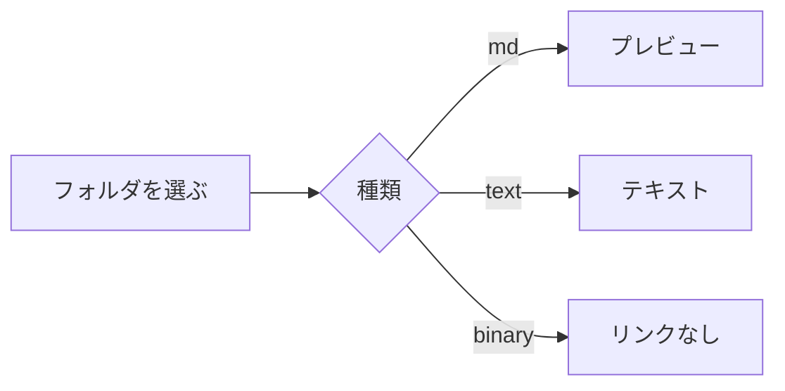

# サンプル

これは **md-view** の確認用です。[詳しい説明](docs/guide.md) と [外のリンク](https://example.com)。

| 項目 | 値 |
|---|---|
| A | 1 |



```js
console.log('hello');
```


```html-raw
<svg viewBox="0 0 200 60" xmlns="http://www.w3.org/2000/svg" style="max-width:200px;width:100%">
<defs><marker id="raw-arr" viewBox="0 0 10 10" refX="9" refY="5" markerWidth="7" markerHeight="7" orient="auto"><path d="M1 1L9 5L1 9" fill="none" stroke="#5B7DB1"/></marker></defs>
<rect x="5" y="10" width="60" height="40" rx="6" fill="#E8EEF8" stroke="#5B7DB1"/>
<text x="35" y="35" font-size="12" text-anchor="middle">生の図</text>
<line x1="65" y1="30" x2="130" y2="30" stroke="#5B7DB1" marker-end="url(#raw-arr)"/>
</svg>
<script>document.title='RAW SCRIPT RAN'</script>
<p onclick="alert(1)">生の段落</p>
```
